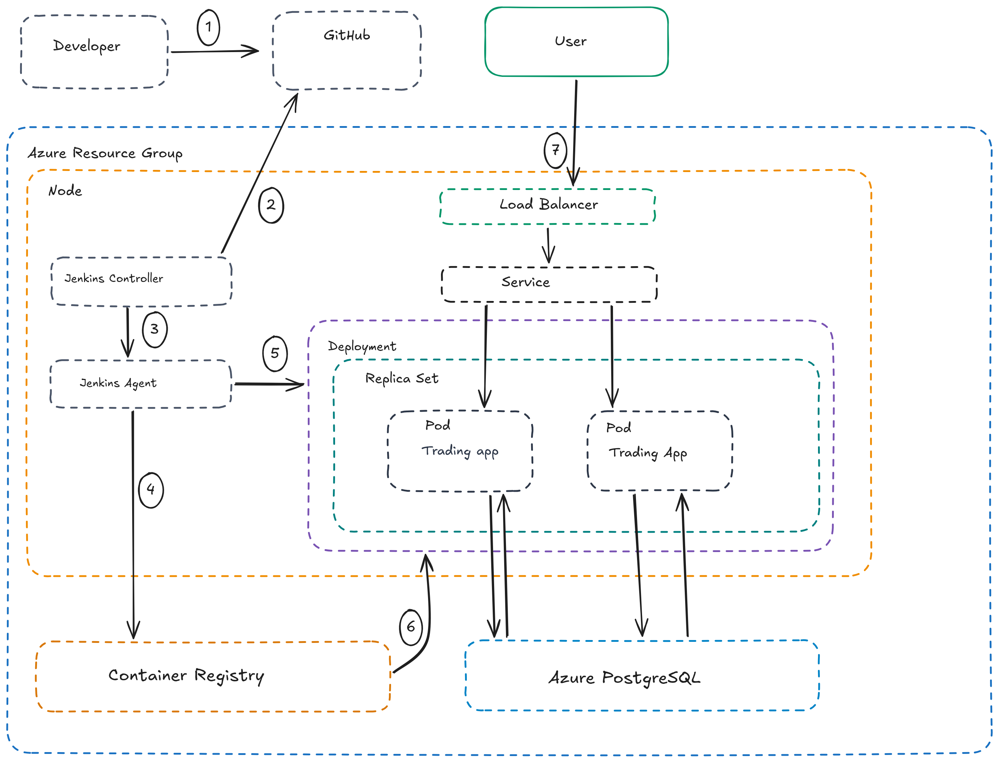

# Introduction

The Trading App is a Spring Boot application that runs on Azure Kubernetes Service (AKS) and stores its data in a managed Azure PostgreSQL database. This project adds a CI/CD pipeline so that every code change pushed to GitHub is built, packaged, and deployed without manual steps.

**Application architecture**

- Users reach the app through an Azure load balancer, which forwards traffic to a Kubernetes Service.
- The Service spreads requests across two identical `trading-app` pods (the application servers).
- The pods read and write data in an Azure Database for PostgreSQL flexible server, which sits outside the cluster but inside the same Azure resource group.
- The application image is stored in Azure Container Registry (ACR).

**Jenkins CI/CD pipeline**

Jenkins runs inside the AKS cluster, installed with the official Jenkins `Helm` chart. The Jenkins controller watches the GitHub repository. When it sees a new commit, it starts a temporary agent pod that builds the Docker image in ACR and tells the Kubernetes Deployment to roll out the new version.

# Application Architecture

The diagram below shows the whole system: the application (load balancer, service, pods, database) and the CI/CD pipeline that deploys it. Each box is drawn inside the Azure resource that owns it.

## Application components

| Component | Role |
|---|---|
| Load Balancer | Public entry point. Azure creates it automatically for a Service of type `LoadBalancer`. |
| Service | Gives the pods one stable address and decides which pod receives each request. |
| Pods (`trading-app`, 2 replicas) | The Spring Boot application, running as a Docker container on port 5000. The pods hold no data, so any pod can serve any request. |
| Azure PostgreSQL | Managed database that stores the application data. Both pods connect to it. |
| Container Registry (ACR) | Stores every built version of the `tradingapp` image. |

## Kubernetes deployment

The same diagram shows how the Kubernetes objects are nested:

- A **Deployment** (`trading-app`) describes the desired state: which image to run and how many copies.
- The Deployment owns a **ReplicaSet**, which keeps exactly two pods running. If a pod crashes, the ReplicaSet starts a replacement.
- The ReplicaSet owns the **pods**. Each pod runs one container, `trading-app-container`.
- The **Service** sits in front of the pods and routes traffic to whichever pods are ready.
- When a new image is deployed, the Deployment performs a **rolling update**. With the default settings and two replicas, it starts one new pod, waits until it is ready, and only then stops an old one, so the app stays available during a release.

# Jenkins CI/CD pipeline

## How Jenkins runs

- The **Jenkins controller** is a pod that runs all the time inside the AKS cluster. It stores the job configuration and credentials and checks GitHub for new commits (SCM polling).
- A **Jenkins agent** is a temporary pod. The controller creates one for each build, the pipeline runs inside it, and the pod is deleted when the build finishes.
- The agent image contains the Azure CLI and `kubectl`. It signs in to Azure with a service principal that is stored in Jenkins credentials, so no passwords appear in the repository.

## Pipeline stages

The numbers match the steps in the diagram.

| Step | Stage | What happens |
|---|---|---|
| 1 | Push | The developer pushes code to GitHub. |
| 2 | Detect change | The Jenkins controller polls GitHub and sees a new commit on the branch. |
| 3 | Start agent | The controller asks Kubernetes to create an agent pod for this build. |
| 4 | Clone and build | The agent clones the repository. `az acr build` then builds the Docker image inside ACR (Maven compiles and packages the app in the Dockerfile) and pushes it with a unique tag. |
| 5 | Deploy | The agent runs `kubectl set image` to point the `trading-app` Deployment at the new tag, then `kubectl rollout status` to wait for the rollout to finish. If the rollout fails, the Jenkins build fails. |
| 6 | Pull image | Kubernetes pulls the new image from ACR onto the node and the rolling update replaces the old pods. |
| 7 | Serve traffic | Users reach the updated pods through the load balancer and Service. |

Every build uses a new image tag. If the tag never changed, Kubernetes would see no difference in the Deployment and would not start a rollout.

To undo a bad release, run `kubectl rollout undo deployment/trading-app`.

# Improvements

1. **Run automated tests in the pipeline.** The Dockerfile builds with `-DskipTests`, so a broken change can reach the cluster. Adding a test stage (for example `mvn test`) before the build would stop bad code early.
2. **Use GitHub webhooks instead of polling.** Polling checks the repository every minute whether or not anything changed. A webhook would start a build the moment code is pushed, and would reduce load on Jenkins and GitHub.
3. **Improve secrets handling.** Move the database credentials and the Azure service principal to Azure Key Vault, and use workload identity so the pipeline needs no long-lived secret.
5. **Use a safer release strategy for prod.** Blue-green or canary deployments would let the team test the new version with limited traffic and switch back instantly if something is wrong.
6. **Package the app as a Helm chart.** A chart would manage the dev and prod configuration from one template instead of separate YAML files.